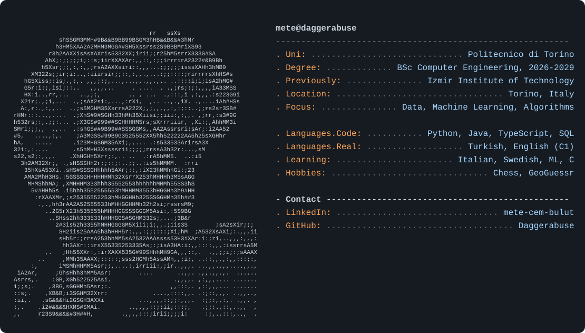

<picture>
  <source media="(prefers-color-scheme: dark)" srcset="dark_mode.svg">
  <source media="(prefers-color-scheme: light)" srcset="light_mode.svg">
  
</picture>

### Projects

| Project | What it is | Tech |
| --- | --- | --- |
| [cmoon](https://github.com/Daggerabuse/cmoon) | ML-based crypto trading strategy with backtesting and walk-forward validation, built as a team for the Code Night competition | Python, scikit-learn, pandas |
| [Dormitory Management Database](https://github.com/Daggerabuse/CENG315_Project_G17) | 18-table Oracle database with triggers for room capacity and stock control | SQL, PL/SQL |
| [haydos-app](https://github.com/IYTE-Yazilim-Toplulugu/haydos-app) | Team-built app by the IZTECH Software Society development team | TypeScript |
| [Incan Gold](https://github.com/AlluvianDev/IncanGold) | Board game simulation built on a generic, array-based Bag ADT | Java |
